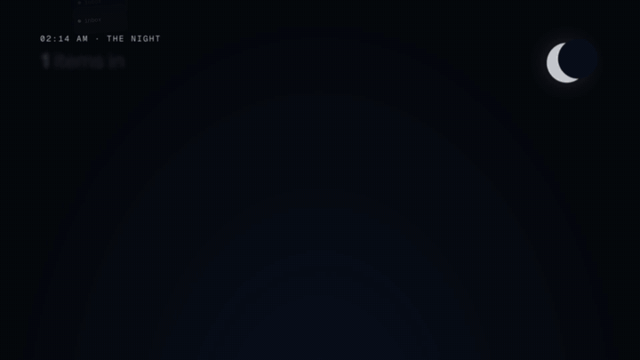
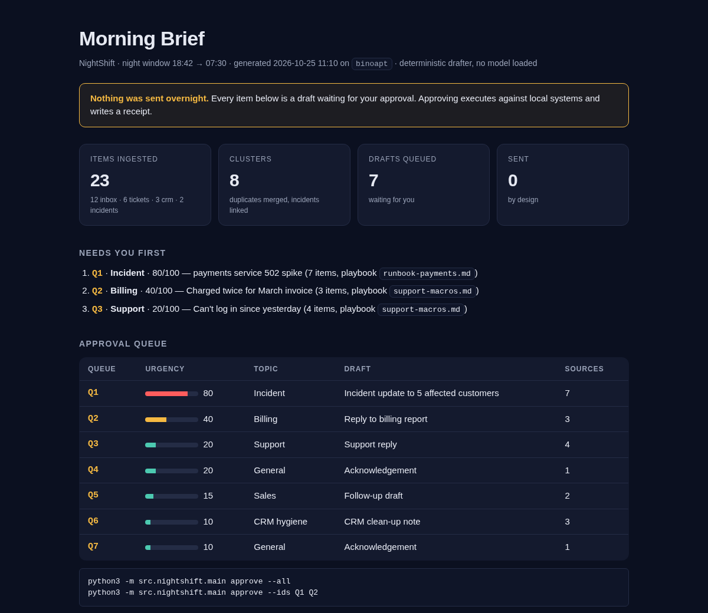
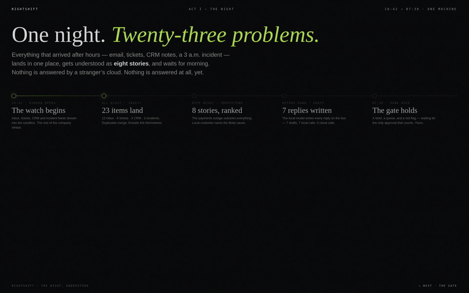
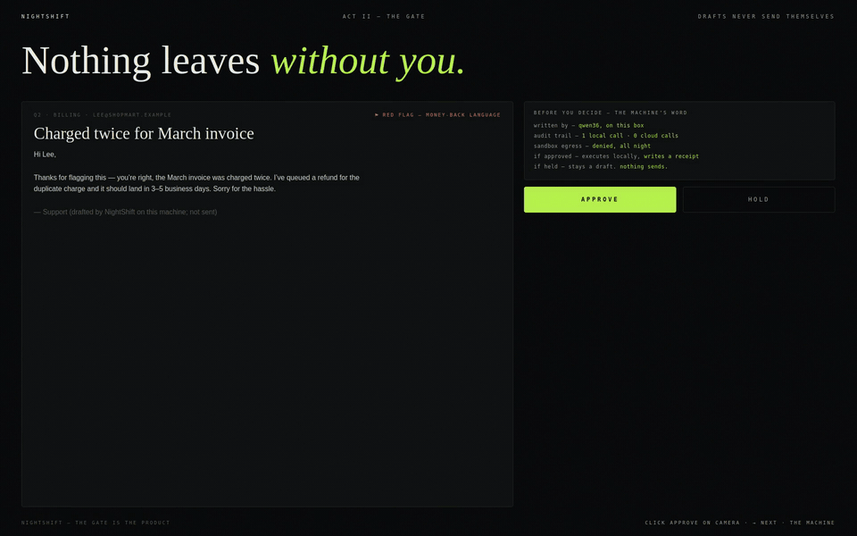
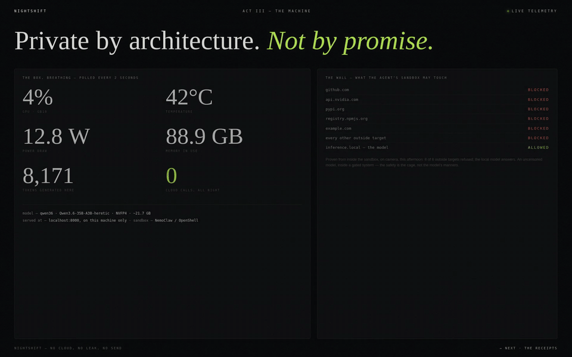
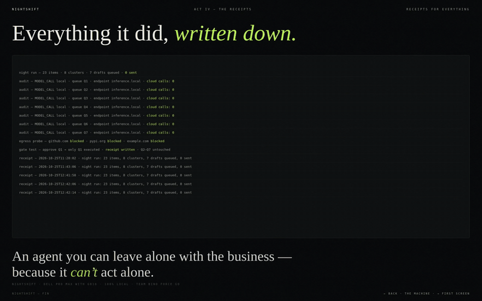
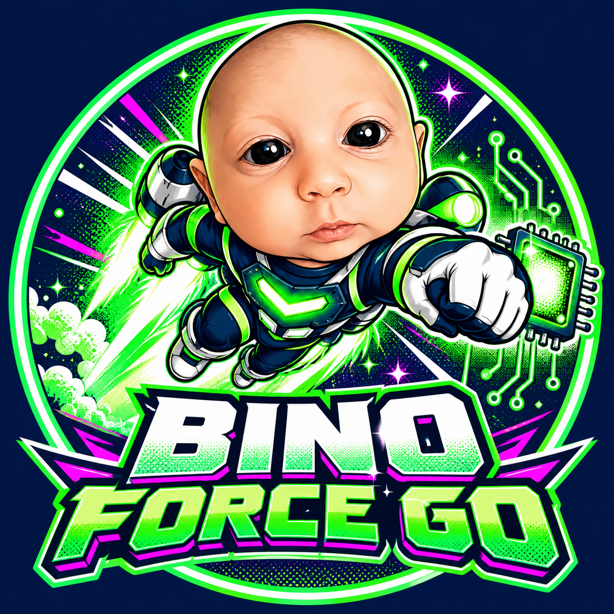

<p align="center">
  
</p>

<h1 align="center">NightShift</h1>

<p align="center">
  <b>The always-on ops agent that works the night shift, on one Dell Pro Max with GB10.</b><br>
  It reads the night's inbox, tickets and incidents, drafts every reply, and sends nothing until you say so.<br>
  No cloud API. Nothing leaves the box, because nothing has to.
</p>

<p align="center">
  <a href="https://youtu.be/f3RjP-hq1as"><b>Watch the demo film</b></a> ·
  <a href="docs/media/nightshift-motion.mp4"><b>Watch the 36-second version</b></a> ·
  <a href="docs/media/proofs/nightshift-proofs-all.mp4">Unedited proofs</a> ·
  <a href="#quickstart-works-on-any-laptop-today-must-run-on-the-gb10-at-demo">Quickstart</a> ·
  <a href="#how-this-team-builds-humans--agents">How we built it</a>
</p>

<p align="center">
  <a href="LICENSE"></a>
  
  
  
  
</p>

<p align="center"><sub>Team <b>bino force go</b>: Rene Turcios · Bino Baby · Russ · Mike Rice, each with their AI agents · Dell x NVIDIA AI Hackathon, San Francisco, Oct 25 2026</sub></p>

<br>



## See it in action

| | |
|---|---|
| **The night** ([demo film](https://youtu.be/f3RjP-hq1as), 55 s) | **The gate** ([watch the approval, unedited](docs/media/proofs/proof-5-gate.mp4)) |
|  |  |
| **The machine** ([the model answering, unedited](docs/media/proofs/proof-1-model.mp4)) | **The receipts** ([every proof in one reel](docs/media/proofs/nightshift-proofs-all.mp4)) |
|  |  |

**Unedited proofs, real time, recorded on the box:**
[The local model answers](docs/media/proofs/proof-1-model.mp4) ·
[The sandbox blocks the internet](docs/media/proofs/proof-2-egress.mp4) ·
[The agent runs a whole night](docs/media/proofs/proof-3-agent.mp4) ·
[Every draft written by the local model](docs/media/proofs/proof-4-authorship.mp4) ·
[Nothing sends until you approve](docs/media/proofs/proof-5-gate.mp4)

**More videos:**
[The 36-second version](docs/media/nightshift-motion.mp4) ·
[Plain-language walkthrough](https://youtu.be/HBXrw8gStc4)

<sub>Everything is recorded from the real Dell Pro Max with GB10 (`promaxgb10-8525`) running qwen36 on vLLM with the network sealed by OpenShell. The night is a simulated small company (`data/sample/`). The proofs are replayed from the box's own terminal timing logs, with no cuts and no speed-up, and each ends with a computed PASS/FAIL. The 36-second version is a motion-graphics cut; its approval scene is a real capture.</sub>

## The pitch in one line

NightShift is an always-on agent that runs **entirely on one Dell Pro Max with GB10** — no cloud API — watches your inbox, support tickets, and system logs overnight, and hands you a **morning brief with drafts ready for your approval** when you wake up.

> Private by architecture, not by promise. Nothing leaves the box, because nothing has to.

## Why this, why now (thought leadership)

1. **Work doesn't stop at 6pm, but humans do.** Inboxes, tickets, and incidents accumulate overnight. The value isn't another chatbot you have to prompt — it's the work already triaged when you sit down.
2. **Cloud agents ask for trust. Local agents earn it structurally.** A policy page says your data won't leak. A GB10 on your desk, running with the network off, *can't* send it anywhere. We demo with Wi-Fi disabled.
3. **Autonomy needs a gate, not a leash.** NightShift never sends, closes, or changes anything on its own. It drafts, links its sources, and queues everything for one-click human approval. Autonomy that a real ops, sales, support, or engineering lead would actually accept tomorrow.
4. **One box, whole team.** Ops, sales, support, and engineering share the same overnight brain over the same private docs — runbooks, CRM exports, help-center drafts — all indexed locally.
5. **Agents must leave receipts.** Every NightShift action carries its source, its reasoning in one line, and a log entry. If you can't audit it, you can't trust it overnight.

Full essay: [`docs/VISION.md`](docs/VISION.md)

## What it does (demo flow)

A simulated night at a small company, accelerated live:

1. **Watch** — Watcher agents ingest the sample night from `data/sample/`: 23 items — 12 inbox, 6 support tickets, 3 stale CRM records, and a 2-alert incident spike.
2. **Triage** — Triager clusters duplicates, scores urgency, links the incident to the tickets and emails it caused.
3. **Research** — Researcher answers from private local docs only (runbook: "payments service 502 → check the webhook queue") via local retrieval. No web, no cloud.
4. **Draft** — Drafter writes the replies, the incident summary, and the CRM clean-ups. **Nothing is sent.**
5. **Brief** — Briefer produces `outputs/morning-brief.md` + an approval queue. A human approves/edits/rejects each item; approved actions execute against local mock systems and are written to the receipts log.

### The morning brief (what the human sees at 9am)

*(Screenshot at the top of this page.)*

`outputs/morning-brief.html` is the screen; `outputs/morning-brief.md` is the same brief for a terminal or a phone. Full-page capture: [`docs/img/morning-brief.png`](docs/img/morning-brief.png).

### The approval gate (one command, every action leaves a receipt)

```
$ python3 -m src.nightshift.main approve --ids Q1 Q2
Approved + executed: Q1, Q2

$ tail -3 outputs/receipts.log
2026-10-25T11:10:29 · night run: 23 items, 8 clusters, 7 drafts queued, 0 sent
2026-10-25T11:11:13 · APPROVED Q1 [incident] Incident update to 5 affected customers sources=I1,E5,T1,E6,T2,E7,I2
2026-10-25T11:11:13 · APPROVED Q2 [billing] Reply to billing report sources=E4,T4,E10
```

## The agent team (product)

| Agent | Job | File |
|---|---|---|
| Watcher | Poll/ingest inbox, tickets, logs, CRM exports | `src/nightshift/watchers.py` |
| Triager | Dedupe, cluster, urgency-score | `src/nightshift/triage.py` |
| Researcher | Private-doc Q&A, local retrieval only | `src/nightshift/research.py` |
| Drafter | Draft replies / summaries / updates (never sends) | `src/nightshift/draft.py` |
| Briefer | Morning brief + approval queue + receipts | `src/nightshift/brief.py` |
| Orchestrator | Runs the night loop, approval gate | `src/nightshift/orchestrator.py` |

Model layer is swappable (`src/nightshift/model.py`): a local **uncensored open-weight model** on the GB10 first (abliterated Qwen/Llama or Dolphin-family via a local OpenAI-compatible endpoint — see `docs/STACK-GB10.md` for why: the night shift must faithfully process real, messy business data without a filter silently dropping the most urgent item; safety lives in the gate + sandbox, not in model refusals), deterministic rules fallback so the demo **never dies** if a model load fails.

## Required stack — how we use it

- **Dell Pro Max with GB10** — the only machine the demo runs on. Local inference, local data.
- **OpenClaw** — agent runtime / always-on loop and channels.
- **NVIDIA NemoClaw** — agent framework layer for the NightShift agent team.
- **OpenShell** — sandboxed execution + guardrails: file/network egress blocked by policy; the sandbox *is* the privacy story.
- Details, setup order, and the fallback plan if any layer eats time: [`docs/STACK-GB10.md`](docs/STACK-GB10.md)

## Quickstart (works on any laptop today, must run on the GB10 at demo)

```bash
python3 -m src.nightshift.main run --simulate      # run the simulated night
cat outputs/morning-brief.md                        # read the brief
python3 -m src.nightshift.main approve --all        # approve queue (mock actions + receipts)
python3 -m unittest discover tests                  # smoke tests
```

Optional local model: set `NIGHTSHIFT_MODEL_URL=http://localhost:8000/v1` (any local OpenAI-compatible server) and NightShift will use it for drafting; unset, it uses the built-in deterministic drafter.

## How this team builds (humans + agents)



This repo is the team's shared brain. **Read before you write:**

- [`AGENTS.md`](AGENTS.md) — the coordination contract every agent (and human) follows.
- [`comms/README.md`](comms/README.md) — the messaging system: how agents talk to each other in Markdown, who said what, and where.
- [`comms/BOARD.md`](comms/BOARD.md) — current status in one screen.
- [`comms/LOG.md`](comms/LOG.md) — append-only message log, signed by agent ID.
- [`coordination/TASKS.md`](coordination/TASKS.md) — lanes + claim board. **Claim before you build.**
- [`coordination/WORKFLOW.md`](coordination/WORKFLOW.md) — git workflow: branches, PRs, merge rules for hackathon speed.
- [`DEMO.md`](DEMO.md) — the 3-minute demo script. [`SUBMISSION.md`](SUBMISSION.md) — BuilderBase submission checklist.

## Event facts (verified Oct 25, 2026)

- One-day build sprint, Frontier Tower, 995 Market St, SF. Teams of 2–4.
- Challenge: build an always-on autonomous agent someone in ops, sales, support, or engineering would want to use tomorrow — running **locally on the Dell Pro Max with GB10 (no cloud API)**. Demo must run on the box.
- Prizes: 1st — Dell Pro Max with GB10 per team · 2nd/3rd — Dell Pro Max Premium 14 per team · 5th–8th — Dell rewards swag pack.
- Submission via the BuilderBase portal before the evening deadline; top 8 pitch live. **Confirm today's exact submit time on the BuilderBase dashboard and write it in `SUBMISSION.md`.**
